# HexaHome Database Architecture & Entity Relationship Diagram (Phase 4 Deliverable)

Target Database: **PostgreSQL 16** with **PostGIS 3.4** and **pg_trgm** extensions.  
Migration Engine: **Flyway** (`db/migration/V1__init_schema.sql`, `V2__seed_data.sql`).

---

## 1. Architectural Design & Entity Rationale

### 1.1 Shared Base Table vs. Type-Specific Details
Real estate platforms feature vastly different attributes across categories:
- **Residential (Flat/House/Villa)**: BHK count, bathrooms, balconies, carpet/built-up area, furnishing, tenant preference (family/bachelor).
- **PG & Co-Living**: Sharing type (Single, Double, Triple), meal services (veg/non-veg), notice period, deposit in months, gate timings, gender restriction (Girls, Boys, Unisex).
- **Commercial**: Property sub-type (Office, Shop, Warehouse, Showroom), floor load capacity, power load (kVA), ceiling height, passenger/goods lifts.
- **Plots & Land**: Plot area, dimension (length x breadth), boundary wall status, corner plot, facing direction, gated community status.

#### Architectural Choice: Hybrid Base-Plus-Extension Pattern
1. **Base Table (`properties`)**: Stores common attributes essential for global search, sorting, and lifecycle management:
   - Identifiers: `id`, `short_id` (6-char unique uppercase ID like `XAT594` or `9GRHEZ`), `slug` (unique SEO string), `owner_id`.
   - Core Financials: `price` (rent or sale price in INR), `deposit`, `maintenance_charges`.
   - Spatial Location: `city_id`, `locality_id`, `location` as `geography(Point, 4326)`, `address`.
   - Classification: `ad_type` (`RENT`, `SALE`, `PLOT`, `PG`), `property_type` (`FLAT`, `HOUSE`, `VILLA`, `COMMERCIAL`, `PLOT`, `PG`).
   - Moderation & Status: `status` (`DRAFT`, `PENDING_VERIFICATION`, `ACTIVE`, `REJECTED`, `EXPIRED`, `SOLD_RENTED`), `is_verified`, `is_zero_brokerage`, `is_hot_deal`.
   - Search Vector: `search_vector` generated column (`tsvector`) for full-text queries.

2. **Dedicated Relational Tables (`pg_details`, `commercial_details`, `plot_details`)**:
   - Used for attributes that require **exact filtering, range checks, and indexes** (e.g. `gender_allowed`, `sharing_type`, `boundary_wall`, `power_load_kva`).
   - Strong foreign key constraint with `ON DELETE CASCADE` ensures data integrity.

3. **JSONB Column (`properties.metadata`)**:
   - Used for non-relational, variable checklists such as furniture items present (AC count, TV, modular kitchen), dynamic amenities flags, and vendor-specific tagging.

---

## 2. Indexing Strategy

1. **Spatial Indexing (`location`)**:
   - `CREATE INDEX idx_properties_location ON properties USING GIST (location);`
   - Enables sub-millisecond radius search queries (`ST_DWithin(location, ST_MakePoint(lng, lat)::geography, radius_meters)`).
2. **Full-Text Search (`search_vector`)**:
   - `CREATE INDEX idx_properties_search_vector ON properties USING GIN (search_vector);`
   - Covers title, description, locality name, and city name with language stemming.
3. **Trigram Autocomplete (`cities.name`, `localities.name`)**:
   - `CREATE INDEX idx_cities_name_trgm ON cities USING GIN (name gin_trgm_ops);`
   - `CREATE INDEX idx_localities_name_trgm ON localities USING GIN (name gin_trgm_ops);`
   - Powers fast autocomplete without Elasticsearch/OpenSearch.
4. **High-Velocity Composite B-Tree Filter Indexes**:
   - `CREATE INDEX idx_properties_city_ad_price ON properties (city_id, ad_type, status, price);`
   - `CREATE INDEX idx_properties_locality_bhk_price ON properties (locality_id, bhk, price) WHERE status = 'ACTIVE';`

---

## 3. Entity-Relationship Diagram (Mermaid)

```mermaid
erDiagram
    USERS ||--o{ PROPERTIES : "owns/posts"
    USERS ||--o{ SAVED_SEARCHES : "creates"
    USERS ||--o{ WISHLISTS : "saves"
    USERS ||--o{ LEADS : "submits/receives"
    USERS ||--o{ CONTACT_VIEWS : "consumes quota"
    USERS ||--o{ SUBSCRIPTIONS : "subscribes"
    USERS ||--o{ NOTIFICATIONS : "receives"
    USERS ||--o{ REPORTS : "files"
    USERS }o--o{ USER_ROLES : "assigned"
    ROLES ||--o{ USER_ROLES : "defines"

    CITIES ||--o{ LOCALITIES : "contains"
    CITIES ||--o{ PROPERTIES : "located_in"
    LOCALITIES ||--o{ PROPERTIES : "located_in"

    PROPERTIES ||--o{ PROPERTY_IMAGES : "has"
    PROPERTIES }o--o{ PROPERTY_AMENITIES : "has"
    AMENITIES ||--o{ PROPERTY_AMENITIES : "includes"
    PROPERTIES ||--o| PG_DETAILS : "extends"
    PROPERTIES ||--o| COMMERCIAL_DETAILS : "extends"
    PROPERTIES ||--o| PLOT_DETAILS : "extends"
    PROPERTIES ||--o{ LEADS : "generates"
    PROPERTIES ||--o{ CONTACT_VIEWS : "tracked_on"
    PROPERTIES ||--o{ WISHLISTS : "bookmarked_in"
    PROPERTIES ||--o{ REPORTS : "reported_in"

    PLANS ||--o{ SUBSCRIPTIONS : "purchased_as"
    SUBSCRIPTIONS ||--o{ PAYMENTS : "billed_by"

    BLOG_CATEGORIES ||--o{ BLOGS : "categorizes"
    FAQ_CATEGORIES ||--o{ FAQS : "categorizes"

    USERS {
        uuid id PK
        varchar phone UK
        varchar email
        varchar name
        varchar profile_pic_url
        boolean is_verified
        boolean is_active
        timestamp created_at
        timestamp updated_at
    }

    ROLES {
        int id PK
        varchar name UK
        varchar description
    }

    CITIES {
        int id PK
        varchar name UK
        varchar state
        varchar slug UK
        geography coordinates
        int display_order
        boolean is_active
    }

    LOCALITIES {
        int id PK
        int city_id FK
        varchar name
        varchar slug UK
        geography coordinates
        int pin_code
    }

    PROPERTIES {
        uuid id PK
        varchar short_id UK "e.g. XAT594"
        varchar slug UK
        uuid owner_id FK
        int city_id FK
        int locality_id FK
        varchar ad_type "RENT, SALE, PLOT, PG"
        varchar property_type "FLAT, HOUSE, VILLA, COMMERCIAL, PLOT"
        varchar title
        text description
        numeric price
        numeric deposit
        numeric maintenance_charges
        varchar bhk
        int bedrooms
        int bathrooms
        int balconies
        numeric built_up_area
        numeric carpet_area
        varchar furnishing
        varchar preferred_tenant
        varchar facing
        int floor_number
        int total_floors
        date available_from
        geography location
        text address
        varchar status "ACTIVE, PENDING, EXPIRED"
        boolean is_verified
        boolean is_zero_brokerage
        boolean is_hot_deal
        jsonb metadata
        tsvector search_vector
        timestamp created_at
        timestamp updated_at
    }

    PG_DETAILS {
        uuid id PK
        uuid property_id FK, UK
        varchar gender_allowed "BOYS, GIRLS, UNISEX"
        varchar sharing_types "SINGLE, DOUBLE, TRIPLE"
        boolean food_included
        varchar meals_provided
        varchar notice_period
        numeric deposit_months
        varchar gate_closing_time
    }

    COMMERCIAL_DETAILS {
        uuid id PK
        uuid property_id FK, UK
        varchar commercial_type "OFFICE, SHOP, WAREHOUSE, SHOWROOM"
        numeric power_load_kva
        numeric ceiling_height_ft
        boolean goods_lift_available
        numeric parking_slots
    }

    PLOT_DETAILS {
        uuid id PK
        uuid property_id FK, UK
        numeric plot_length
        numeric plot_breadth
        boolean boundary_wall
        boolean corner_plot
        boolean gated_community
        numeric road_width_ft
    }

    PROPERTY_IMAGES {
        uuid id PK
        uuid property_id FK
        varchar image_url
        varchar thumbnail_url
        varchar caption
        int display_order
        boolean is_cover
        timestamp created_at
    }

    AMENITIES {
        int id PK
        varchar code UK "LIFT, GYM, POOL"
        varchar name
        varchar icon_url
        varchar category
    }

    LEADS {
        uuid id PK
        uuid property_id FK
        uuid seeker_id FK
        varchar seeker_name
        varchar seeker_phone
        varchar message
        varchar status "NEW, CONTACTED, VISITED, CLOSED"
        timestamp created_at
    }

    CONTACT_VIEWS {
        uuid id PK
        uuid user_id FK
        uuid property_id FK
        numeric credit_deducted
        timestamp viewed_at
    }

    PLANS {
        varchar id PK "plan_tenant_pro"
        varchar name
        varchar target_role
        numeric price_inr
        int validity_days
        int contact_credits
        boolean has_assisted_manager
        boolean instant_whatsapp_alerts
        boolean is_active
    }

    SUBSCRIPTIONS {
        uuid id PK
        uuid user_id FK
        varchar plan_id FK
        int total_credits
        int remaining_credits
        timestamp starts_at
        timestamp expires_at
        varchar status "ACTIVE, EXPIRED, CANCELLED"
    }

    PAYMENTS {
        uuid id PK
        uuid subscription_id FK
        uuid user_id FK
        varchar order_id UK
        varchar payment_id UK
        varchar gateway "RAZORPAY, CASHFREE"
        numeric amount_inr
        varchar status "PENDING, SUCCESS, FAILED"
        timestamp created_at
    }

    WISHLISTS {
        uuid id PK
        uuid user_id FK
        uuid property_id FK
        timestamp created_at
    }

    SAVED_SEARCHES {
        uuid id PK
        uuid user_id FK
        varchar title
        jsonb filter_criteria
        boolean whatsapp_alert
        boolean email_alert
        timestamp created_at
    }

    REPORTS {
        uuid id PK
        uuid property_id FK
        uuid reported_by_user_id FK
        varchar reason
        text comments
        varchar status "PENDING, RESOLVED, DISMISSED"
        timestamp created_at
    }

    BLOGS {
        uuid id PK
        varchar slug UK
        varchar title
        text content
        varchar cover_image_url
        varchar meta_title
        varchar meta_description
        timestamp published_at
    }

    FAQS {
        int id PK
        varchar question
        text answer
        varchar category
        int display_order
    }
```

